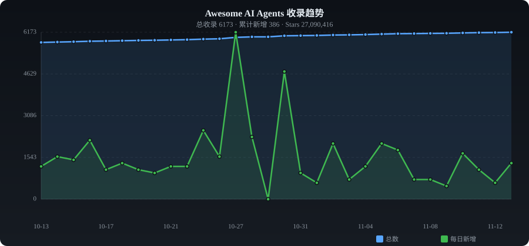

# ✨ Awesome AI Agents

**English** | [中文](./README_ZH.md)

> Curated collection of AI agent frameworks, orchestration tools & multi-agent platforms — auto-collected from GitHub

   

---

## 📈 Trends

---

## 📊 Category Stats

| Category | Count | Share |
|----------|------:|------:|
| 🏗️ General Frameworks | 1100 | █████ 18.0% |
| 👥 Multi-Agent | 508 | ██ 8.3% |
| 💻 Coding Agents | 1505 | ████████ 24.6% |
| 🌐 Browser Agents | 528 | ██ 8.6% |
| 🔀 Workflow & Orchestration | 991 | █████ 16.2% |
| 📚 RAG & Knowledge | 472 | ██ 7.7% |
| 💬 Chat & Conversational | 315 | █ 5.1% |
| ⚡ Automation & RPA | 104 | █ 1.7% |
| 🔬 Research & Papers | 118 | █ 1.9% |
| 📦 Others | 477 | ██ 7.8% |

---

## 🔥 Daily Trending (2026-11-06)

| # | Project | ⭐ | 📈 Gain | Description |
|:-:|---------|---:|-------:|-------------|
| 1 | [feder-cr/dots](https://github.com/feder-cr/dots) | 31,782 | +29154 | Open-source dots for the web: an AI agent with its own brows |
| 2 | [nirholas/claude-code](https://github.com/nirholas/claude-code) | 6,368 | +6062 | Claude Code is an agentic coding tool that lives in your ter |
| 3 | [morluto/rea](https://github.com/morluto/rea) | 436,310 | +3490 | Reverse engineer anything with agents, from app behavior dow |
| 4 | [cloudflare/security-audit-skill](https://github.com/cloudflare/security-audit-skill) | 62,786 | +2532 | A coding-agent skill for multi-phase security audits with in |
| 5 | [chopratejas/headroom](https://github.com/chopratejas/headroom) | 42,897 | +2527 | The Context Optimization Layer for LLM Applications |
| 6 | [NVIDIA/auto-ontology](https://github.com/NVIDIA/auto-ontology) | 8,323 | +1942 | Auto Ontology is a Python framework for building semantic, g |
| 7 | [vercel-labs/agent-desktop](https://github.com/vercel-labs/agent-desktop) | 17,691 | +1524 | Agent Desktop gives any agent reliable computer use on the d |
| 8 | [block/goose](https://github.com/block/goose) | 37,609 | +1467 | an open source, extensible AI agent that goes beyond code su |
| 9 | [stablyai/orca](https://github.com/stablyai/orca) | 117,286 | +1161 | Orca is the next-gen IDE for building with coding agents |
| 10 | [AhmadHassan-BTed/OpenOPC-Shadow-Adapter](https://github.com/AhmadHassan-BTed/OpenOPC-Shadow-Adapter) | 1,603 | +1012 | Zero-modification Human-in-the-Loop adapter for OpenOPC's ag |
| 11 | [affaan-m/everything-claude-code](https://github.com/affaan-m/everything-claude-code) | 186,220 | +989 | The agent harness performance optimization system. Skills, i |
| 12 | [pbakaus/impeccable](https://github.com/pbakaus/impeccable) | 104,382 | +973 | The design vocabulary for your coding agent. Steer with poli |
| 13 | [Ataraxy-Labs/sem](https://github.com/Ataraxy-Labs/sem) | 2,891 | +934 | Semantic version control — entity-level diffs, blame, and im |
| 14 | [deepseek-ai/dsh-superagent-prototype](https://github.com/deepseek-ai/dsh-superagent-prototype) | 20,010 | +822 | Towards a More Autonomous Agent System |
| 15 | [Fei2411/DeepSeek-Bot](https://github.com/Fei2411/DeepSeek-Bot) | 3,815 | +819 | A team of long-lived bots for DeepSeek Harness, with main bo |
| 16 | [farion1231/cc-switch](https://github.com/farion1231/cc-switch) | 149,655 | +788 | A cross-platform desktop All-in-One assistant for Claude Cod |
| 17 | [yetone/magpie](https://github.com/yetone/magpie) | 31,013 | +764 | Every agent's model. One place. Codex on DeepSeek, Claude Co |
| 18 | [affaan-m/ECC](https://github.com/affaan-m/ECC) | 298,217 | +668 | The agent harness performance optimization system. Skills, i |
| 19 | [DietrichGebert/ponytail](https://github.com/DietrichGebert/ponytail) | 185,560 | +665 | Makes your AI agent think like the laziest senior dev in the |
| 20 | [google/elephant-goldfish-model](https://github.com/google/elephant-goldfish-model) | 12,759 | +662 | Open-source skills for designing and reviewing software with |

---

## 📁 Categories

- [🏗️ General Frameworks](#framework) (1100)
- [👥 Multi-Agent](#multi-agent) (508)
- [💻 Coding Agents](#coding) (1505)
- [🌐 Browser Agents](#browser) (528)
- [🔀 Workflow & Orchestration](#workflow) (991)
- [📚 RAG & Knowledge](#rag) (472)
- [💬 Chat & Conversational](#chatbot) (315)
- [⚡ Automation & RPA](#automation) (104)
- [🔬 Research & Papers](#research) (118)
- [📦 Others](#other) (477)

---

### 🏗️ General Frameworks

| Project | ⭐ | Language | Description |
|---------|---:|:--------:|-------------|
| [morluto/rea](https://github.com/morluto/rea) | 436,310 | TypeScript | Reverse engineer anything with agents, from app behavior down to nativ |
| [obra/superpowers](https://github.com/obra/superpowers) | 313,323 | Shell | An agentic skills framework & software development methodology that wo |
| [Snailclimb/JavaGuide](https://github.com/Snailclimb/JavaGuide) | 159,460 | Java | Java 面试 & 后端通用面试指南，覆盖计算机基础、数据库、分布式、高并发、系统设计与 AI 应用开发 |
| [farion1231/cc-switch](https://github.com/farion1231/cc-switch) | 149,655 | Rust | A cross-platform desktop All-in-One assistant for Claude Code, Codex,  |
| [langchain-ai/langchain](https://github.com/langchain-ai/langchain) | 149,120 | Python | The agent engineering platform |
| [TauricResearch/TradingAgents](https://github.com/TauricResearch/TradingAgents) | 120,918 | Python | TradingAgents: Multi-Agents LLM Financial Trading Framework |
| [earendil-works/pi](https://github.com/earendil-works/pi) | 120,426 | TypeScript | AI agent toolkit: coding agent CLI, unified LLM API, TUI & web UI libr |
| [ruvnet/ruflo](https://github.com/ruvnet/ruflo) | 81,039 | TypeScript | 🌊 The leading agent orchestration platform for Claude. Deploy intellig |
| [dair-ai/Prompt-Engineering-Guide](https://github.com/dair-ai/Prompt-Engineering-Guide) | 79,865 | MDX | 🐙 Guides, papers, lessons, notebooks and resources for prompt engineer |
| [heygen-com/hyperframes](https://github.com/heygen-com/hyperframes) | 79,862 | HTML | Write HTML. Render video. Built for agents. |
| [microsoft/ai-agents-for-beginners](https://github.com/microsoft/ai-agents-for-beginners) | 79,034 | Jupyter Notebook | 12 Lessons to Get Started Building AI Agents |
| [openbq-org/OpenBB](https://github.com/openbq-org/OpenBB) | 75,135 | Python | Open Data Platform for analysts, quants and AI agents. |
| [OpenBB-finance/OpenBB](https://github.com/OpenBB-finance/OpenBB) | 73,682 | Python | Financial data platform for analysts, quants and AI agents. |
| [FoundationAgents/MetaGPT](https://github.com/FoundationAgents/MetaGPT) | 71,195 | Python | 🌟 The Multi-Agent Framework: First AI Software Company, Towards Natura |
| [geekan/MetaGPT](https://github.com/FoundationAgents/MetaGPT) | 64,757 | Python | 🌟 The Multi-Agent Framework: First AI Software Company, Towards Natura |
| [upstash/context7](https://github.com/upstash/context7) | 64,274 | TypeScript | Context7 Platform -- Up-to-date docs for AI agents |
| [microsoft/autogen](https://github.com/microsoft/autogen) | 61,730 | Python | A programming framework for agentic AI |
| [crewAIInc/crewAI](https://github.com/crewAIInc/crewAI) | 60,564 | Python | Framework for orchestrating role-playing, autonomous AI agents. By fos |
| [coreyhaines31/marketingskills](https://github.com/coreyhaines31/marketingskills) | 58,824 | JavaScript | Marketing skills for Claude Code and AI agents. CRO, copywriting, SEO, |
| [K-Dense-AI/scientific-agent-skills](https://github.com/K-Dense-AI/scientific-agent-skills) | 56,280 | Python | A set of ready to use Agent Skills for research, science, engineering, |
| [DavidHDev/react-bits](https://github.com/DavidHDev/react-bits) | 51,372 | JavaScript | The largest open-source library of animated, interactive, and customiz |
| [badlogic/pi-mono](https://github.com/badlogic/pi-mono) | 45,783 | TypeScript | AI agent toolkit: coding agent CLI, unified LLM API, TUI & web UI libr |
| [joaomdmoura/CrewAI](https://github.com/crewAIInc/crewAI) | 45,102 | Python | Framework for orchestrating role-playing, autonomous AI agents. By fos |
| [joaomdmoura/crewAI](https://github.com/crewAIInc/crewAI) | 45,102 | Python | Framework for orchestrating role-playing, autonomous AI agents. By fos |
| [joaomdmoura/crewai](https://github.com/crewAIInc/crewAI) | 45,102 | Python | Framework for orchestrating role-playing, autonomous AI agents. By fos |
| [chopratejas/headroom](https://github.com/chopratejas/headroom) | 42,897 | Python | The Context Optimization Layer for LLM Applications |
| [ToolJet/ToolJet](https://github.com/ToolJet/ToolJet) | 41,202 | JavaScript | ToolJet is the open-source foundation of ToolJet AI - the AI-native pl |
| [patchy631/ai-engineering-hub](https://github.com/patchy631/ai-engineering-hub) | 41,197 | Jupyter Notebook | In-depth tutorials on LLMs, RAGs and real-world AI agent applications. |
| [github/awesome-copilot](https://github.com/github/awesome-copilot) | 40,870 | Python | Community-contributed instructions, agents, skills, and configurations |
| [PostHog/posthog](https://github.com/PostHog/posthog) | 40,672 | Python | :hedgehog: PostHog is the leading platform for building self-driving p |
| [mindsdb/mindsdb](https://github.com/mindsdb/mindsdb) | 39,164 | Python | Query Engine for AI Analytics: Build self-reasoning agents across all  |
| [medusajs/medusa](https://github.com/medusajs/medusa) | 37,112 | TypeScript | The world's most flexible commerce platform for agents and developers |
| [langfuse/langfuse](https://github.com/langfuse/langfuse) | 37,095 | TypeScript | 🪢 Open source LLM engineering platform: LLM Observability, metrics, ev |
| [esengine/DeepSeek-Reasonix](https://github.com/esengine/DeepSeek-Reasonix) | 36,106 | TypeScript | DeepSeek-native AI coding agent for your terminal. Engineered around p |
| [alibaba/nacos](https://github.com/alibaba/nacos) | 33,500 | Java | an easy-to-use dynamic service discovery, configuration and service ma |
| [SigNoz/signoz](https://github.com/SigNoz/signoz) | 32,538 | TypeScript | SigNoz is an open-source, OpenTelemetry-native observability platform  |
| [trycua/cua](https://github.com/trycua/cua) | 31,857 | Python | Open-source infrastructure for Computer-Use Agents. Sandboxes, SDKs, a |
| [nanocoai/nanoclaw](https://github.com/nanocoai/nanoclaw) | 31,086 | TypeScript | A lightweight alternative to OpenClaw that runs in containers for secu |
| [ComposioHQ/composio](https://github.com/ComposioHQ/composio) | 30,949 | TypeScript | Composio powers 1000+ toolkits, tool search, context management, authe |
| [jackwener/OpenCLI](https://github.com/jackwener/OpenCLI) | 30,928 | TypeScript | Make Any Website & Tool Your CLI. A universal CLI Hub and AI-native ru |

---

### 👥 Multi-Agent

| Project | ⭐ | Language | Description |
|---------|---:|:--------:|-------------|
| [lobehub/lobehub](https://github.com/lobehub/lobehub) | 84,005 | TypeScript | The ultimate space for work and life — to find, build, and collaborate |
| [lobehub/lobe-chat](https://github.com/lobehub/lobehub) | 73,041 | TypeScript | The ultimate space for work and life — to find, build, and collaborate |
| [THU-MAIC/OpenMAIC](https://github.com/THU-MAIC/OpenMAIC) | 42,783 | TypeScript | Open Multi-Agent Interactive Classroom — Get an immersive, multi-agent |
| [Yeachan-Heo/oh-my-claudecode](https://github.com/Yeachan-Heo/oh-my-claudecode) | 40,637 | TypeScript | Teams-first Multi-agent orchestration for Claude Code |
| [HKUDS/Vibe-Trading](https://github.com/HKUDS/Vibe-Trading) | 37,762 | Python | "Vibe-Trading: Your Personal Trading Agent" |
| [OpenBMB/ChatDev](https://github.com/OpenBMB/ChatDev) | 34,691 | Python | ChatDev 2.0: Dev All through LLM-powered Multi-Agent Collaboration |
| [openai/symphony](https://github.com/openai/symphony) | 27,954 | Elixir | Symphony turns project work into isolated, autonomous implementation r |
| [RooCodeInc/Roo-Code](https://github.com/RooCodeInc/Roo-Code) | 24,243 | TypeScript | Roo Code gives you a whole dev team of AI agents in your code editor. |
| [HKUDS/AI-Trader](https://github.com/HKUDS/AI-Trader) | 23,122 | Python | "AI-Trader: 100% Fully-Automated Trading Powered by Agent Swarm Intell |
| [openai/swarm](https://github.com/openai/swarm) | 22,111 | Python | Educational framework exploring ergonomic, lightweight multi-agent orc |
| [gastownhall/gastown](https://github.com/gastownhall/gastown) | 18,713 | Go | Gas Town - multi-agent workspace manager |
| [OrchestratorInc/agent-orchestrator](https://github.com/OrchestratorInc/agent-orchestrator) | 14,161 | Go | Run and supervise teams of coding agents from planning to merge. Any h |
| [steveyegge/gastown](https://github.com/steveyegge/gastown) | 13,300 | Go | Gas Town - multi-agent workspace manager |
| [Untrivial-ai/agent-orchestrator](https://github.com/Untrivial-ai/agent-orchestrator) | 12,719 | Go | Agent IDE that enables you to manage fleets of coding agents. It comes |
| [Nasiko-Labs/nasiko](https://github.com/Nasiko-Labs/nasiko) | 11,854 | Python | Developer Control Plane for your AI Agents |
| [TencentCloud/Octop](https://github.com/TencentCloud/Octop) | 11,731 | Python | A smarter, self-hosted AI assistant — multi-user, multi-agent. |
| [spinabot/brigade](https://github.com/spinabot/brigade) | 11,371 | TypeScript | Brigade — Your personal intelligence, built enterprise-grade |
| [alvinunreal/oh-my-opencode-slim](https://github.com/alvinunreal/oh-my-opencode-slim) | 10,135 | TypeScript | Lean, fine tuned Opencode multi agent suite · Mix any models · Auto de |
| [Narcooo/inkos](https://github.com/Narcooo/inkos) | 9,924 | TypeScript | Multi-agent novel production system — AI agents autonomously write, au |
| [Orkas-AI/Orkas](https://github.com/Orkas-AI/Orkas) | 9,057 | TypeScript | Open-source multi-agent AI desktop client — build and command your AI  |
| [TeamWiseFlow/xiaobei](https://github.com/TeamWiseFlow/xiaobei) | 8,688 | Python | 为 OPC/中小微企业老板们量身打造的"AI 搞钱搭子" |
| [WenyuChiou/awesome-agentic-ai-zh](https://github.com/WenyuChiou/awesome-agentic-ai-zh) | 8,637 | Python | A structured, trilingual (繁中 / 简中 / English) learning roadmap for agen |
| [AgentWrapper/agent-orchestrator](https://github.com/AgentWrapper/agent-orchestrator) | 8,617 | TypeScript | Agentic orchestrator for parallel coding agents — plans tasks, spawns  |
| [Human-Agent-Society/reef](https://github.com/Human-Agent-Society/reef) | 7,803 | Python | Infrastructure for continually self‑improving agents |
| [ringhyacinth/Star-Office-UI](https://github.com/ringhyacinth/Star-Office-UI) | 7,562 | HTML | A pixel office for your OpenClaw: turn invisible work states into a co |
| [ComposioHQ/agent-orchestrator](https://github.com/ComposioHQ/agent-orchestrator) | 7,425 | TypeScript | Agentic orchestrator for parallel coding agents — plans tasks, spawns  |
| [ZSeven-W/openpencil](https://github.com/ZSeven-W/openpencil) | 7,091 | TypeScript | AI-native open-source design tool. Design-as-Code.Prompt to UI on canv |
| [elder-plinius/T3MP3ST](https://github.com/elder-plinius/T3MP3ST) | 6,921 | TypeScript | autonomous red teaming platform; multi-agent offensive-security meta-h |
| [The-Swarm-Corporation/AutoHedge](https://github.com/The-Swarm-Corporation/AutoHedge) | 6,635 | Python | Build your autonomous hedge fund in minutes. AutoHedge harnesses the p |
| [JackChen-me/open-multi-agent](https://github.com/JackChen-me/open-multi-agent) | 6,075 | TypeScript | Production-grade multi-agent orchestration framework. Model-agnostic,  |
| [kuafuai/DevOpsGPT](https://github.com/kuafuai/DevOpsGPT) | 5,971 | HTML | Multi agent system for AI-driven software development. Combine LLM wit |
| [agentscope-ai/AgentTeams](https://github.com/agentscope-ai/AgentTeams) | 5,949 | Go | An open-source Collaborative Multi-Agent OS for transparent, human-in- |
| [nightly-labs/openbot](https://github.com/nightly-labs/openbot) | 5,918 | TypeScript | A local-first desktop workspace for persistent AI teammates. Run Codex |
| [Fei2411/DS-Bot](https://github.com/Fei2411/DS-Bot) | 5,878 | JavaScript | A team of long-lived bots for DeepSeek Harness, with main bots, bot-to |
| [SenteLabsAI/OpenExecutive](https://github.com/SenteLabsAI/OpenExecutive) | 5,751 | Python | AI-powered virtual executive team — a single coherent executive person |
| [MrLesk/Backlog.md](https://github.com/MrLesk/Backlog.md) | 5,534 | TypeScript | Backlog.md - A tool for managing project collaboration between humans  |
| [ApodexAI/FrontierAgent](https://github.com/ApodexAI/FrontierAgent) | 5,432 | Python | 🧩 FrontierAgent, our agent framework, open-sourced alongside it — nati |
| [agentscope-ai/HiClaw](https://github.com/agentscope-ai/HiClaw) | 4,924 | Shell | An open-source Collaborative Multi-Agent OS for transparent, human-in- |
| [LantaoYu/MARL-Papers](https://github.com/LantaoYu/MARL-Papers) | 4,897 | - | Paper list of multi-agent reinforcement learning (MARL) |
| [eastlondoner/vibe-tools](https://github.com/eastlondoner/vibe-tools) | 4,759 | TypeScript | Give Cursor Agent an AI Team and Advanced Skills |

---

### 💻 Coding Agents

| Project | ⭐ | Language | Description |
|---------|---:|:--------:|-------------|
| [affaan-m/ECC](https://github.com/affaan-m/ECC) | 298,217 | JavaScript | The agent harness performance optimization system. Skills, instincts,  |
| [anomalyco/opencode](https://github.com/anomalyco/opencode) | 224,940 | TypeScript | The open source coding agent. |
| [ultraworkers/claw-code](https://github.com/ultraworkers/claw-code) | 194,945 | Rust | An agent-managed museum exhibit, built in Rust with Gajae-Code / LazyC |
| [affaan-m/everything-claude-code](https://github.com/affaan-m/everything-claude-code) | 186,220 | JavaScript | The agent harness performance optimization system. Skills, instincts,  |
| [DietrichGebert/ponytail](https://github.com/DietrichGebert/ponytail) | 185,560 | JavaScript | Makes your AI agent think like the laziest senior dev in the room. The |
| [anthropics/claude-code](https://github.com/anthropics/claude-code) | 154,753 | Shell | Claude Code is an agentic coding tool that lives in your terminal, und |
| [x1xhlol/system-prompts-and-models-of-ai-tools](https://github.com/x1xhlol/system-prompts-and-models-of-ai-tools) | 144,516 | - | FULL Augment Code, Claude Code, Cluely, CodeBuddy, Comet, Cursor, Devi |
| [openai/codex](https://github.com/openai/codex) | 133,438 | Rust | Lightweight coding agent that runs in your terminal |
| [VoltAgent/awesome-design-md](https://github.com/VoltAgent/awesome-design-md) | 125,855 | HTML | Collection of DESIGN.md files that capture design systems from popular |
| [JuliusBrussee/caveman](https://github.com/JuliusBrussee/caveman) | 117,912 | Go | 🪨 why use many token when few token do trick. Viral skill + proxy for  |
| [stablyai/orca](https://github.com/stablyai/orca) | 117,286 | TypeScript | Orca is the next-gen IDE for building with coding agents |
| [addyosmani/agent-skills](https://github.com/addyosmani/agent-skills) | 113,626 | Shell | Production-grade engineering skills for AI coding agents. |
| [Leonxlnx/taste-skill](https://github.com/Leonxlnx/taste-skill) | 111,013 | - | Taste-Skill (High-Agency Frontend) - gives your AI good taste. stops t |
| [Panniantong/Agent-Reach](https://github.com/Panniantong/Agent-Reach) | 109,512 | Python | Give your AI agent eyes to see the entire internet. Read & search Twit |
| [nexu-io/open-design](https://github.com/nexu-io/open-design) | 106,227 | TypeScript | 🎨 The Vibe Design Workspace & the open-source Claude Design alternativ |
| [pbakaus/impeccable](https://github.com/pbakaus/impeccable) | 104,382 | Rust | The design vocabulary for your coding agent. Steer with polish and bol |
| [tt-a1i/archify](https://github.com/tt-a1i/archify) | 94,075 | HTML | Agent skill for beautiful, verifiable architecture, workflow, sequence |
| [OpenHands/OpenHands](https://github.com/OpenHands/OpenHands) | 92,797 | Python | 🙌 OpenHands: AI-Driven Development |
| [Egonex-AI/Understand-Anything](https://github.com/Egonex-AI/Understand-Anything) | 80,950 | TypeScript | Graphs that teach > graphs that impress. Turn any code into an interac |
| [career-ops-hq/career-ops](https://github.com/career-ops-hq/career-ops) | 80,597 | JavaScript | Open-source AI job search: scan job portals, evaluate listings into a  |
| [shareAI-lab/learn-claude-code](https://github.com/shareAI-lab/learn-claude-code) | 79,969 | TypeScript | Bash is all you need -  A nano Claude Code–like agent, built from 0 to |
| [headroomlabs-ai/headroom](https://github.com/headroomlabs-ai/headroom) | 78,985 | Python | Compress tool outputs, logs, files, and RAG chunks before they reach t |
| [calesthio/OpenMontage](https://github.com/calesthio/OpenMontage) | 77,457 | Python | World's first open-source, agentic video production system. 11 pipelin |
| [colbymchenry/codegraph](https://github.com/colbymchenry/codegraph) | 76,884 | TypeScript | Pre-indexed code knowledge graph for Claude Code, Codex, Cursor, OpenC |
| [thedaviddias/Front-End-Checklist](https://github.com/thedaviddias/Front-End-Checklist) | 74,661 | MDX | 🗂 The essential checklist for modern web development, for humans and A |
| [cline/cline](https://github.com/cline/cline) | 71,392 | TypeScript | Autonomous coding agent right in your IDE, capable of creating/editing |
| [santifer/career-ops](https://github.com/santifer/career-ops) | 69,545 | Go | AI-powered job search system built on Claude Code. 14 skill modes, Go  |
| [openinterpreter/openinterpreter](https://github.com/openinterpreter/openinterpreter) | 68,817 | Python | A lightweight coding agent for open models like Deepseek, Kimi, and Qw |
| [shanraisshan/claude-code-best-practice](https://github.com/shanraisshan/claude-code-best-practice) | 68,658 | HTML | from vibe coding to agentic engineering - practice makes claude perfec |
| [code-yeongyu/oh-my-openagent](https://github.com/code-yeongyu/oh-my-openagent) | 68,643 | TypeScript | omo; the best agent harness - previously oh-my-opencode |
| [OpenDevin/OpenDevin](https://github.com/OpenHands/OpenHands) | 68,529 | Python | 🙌 OpenHands: AI-Driven Development |
| [mvanhorn/last30days-skill](https://github.com/mvanhorn/last30days-skill) | 66,797 | Python | AI agent skill that researches any topic across Reddit, X, YouTube, HN |
| [blader/humanizer](https://github.com/blader/humanizer) | 65,459 | Python | Agent skill that removes signs of AI-generated writing from text |
| [OpenInterpreter/open-interpreter](https://github.com/openinterpreter/openinterpreter) | 64,277 | Rust | A lightweight coding agent for open models like Deepseek, Kimi, and Qw |
| [KillianLucas/open-interpreter](https://github.com/openinterpreter/openinterpreter) | 63,856 | Python | A lightweight coding agent for open models like Deepseek, Kimi, and Qw |
| [cloudflare/security-audit-skill](https://github.com/cloudflare/security-audit-skill) | 62,786 | JavaScript | A coding-agent skill for multi-phase security audits with independentl |
| [ayghri/i-have-adhd](https://github.com/ayghri/i-have-adhd) | 60,297 | - | A skill for your coding agent to stop it from burying the answer. ADHD |
| [hesreallyhim/awesome-claude-code](https://github.com/hesreallyhim/awesome-claude-code) | 57,375 | Python | A curated list of awesome skills, hooks, slash-commands, agent orchest |
| [aaif-goose/goose](https://github.com/aaif-goose/goose) | 56,293 | Rust | an open source, extensible AI agent that goes beyond code suggestions  |
| [AntonOsika/gpt-engineer](https://github.com/AntonOsika/gpt-engineer) | 55,210 | Python | CLI platform to experiment with codegen. Precursor to: https://lovable |

---

### 🌐 Browser Agents

| Project | ⭐ | Language | Description |
|---------|---:|:--------:|-------------|
| [firecrawl/firecrawl](https://github.com/firecrawl/firecrawl) | 199,105 | TypeScript | 🔥 The Web Data API for AI - Power AI agents with clean web data |
| [browser-use/browser-use](https://github.com/browser-use/browser-use) | 120,190 | Python | 🌐 Make websites accessible for AI agents. Automate tasks online with e |
| [unclecode/crawl4ai](https://github.com/unclecode/crawl4ai) | 86,982 | Python | Open-source web crawler and scraper for LLMs and AI agents: any websit |
| [appwrite/appwrite](https://github.com/appwrite/appwrite) | 57,874 | TypeScript | The open-source cloud for agents & devs. Including Auth, Databases, St |
| [ChromeDevTools/chrome-devtools-mcp](https://github.com/ChromeDevTools/chrome-devtools-mcp) | 54,871 | TypeScript | Chrome DevTools for coding agents |
| [siyuan-note/siyuan](https://github.com/siyuan-note/siyuan) | 47,102 | TypeScript | A privacy-first, self-hosted, fully open source personal knowledge man |
| [vercel-labs/agent-browser](https://github.com/vercel-labs/agent-browser) | 46,220 | Rust | Browser automation CLI for AI agents |
| [bytedance/UI-TARS-desktop](https://github.com/bytedance/UI-TARS-desktop) | 39,558 | TypeScript | The Open-Source Multimodal AI Agent Stack: Connecting Cutting-Edge AI  |
| [1Panel-dev/1Panel](https://github.com/1Panel-dev/1Panel) | 37,379 | Go | 🔥 1Panel is a modern, open-source VPS control panel — and the only one |
| [reworkd/AgentGPT](https://github.com/reworkd/AgentGPT) | 36,265 | TypeScript | 🤖 Assemble, configure, and deploy autonomous AI Agents in your browser |
| [feder-cr/Jobs_Applier_AI_Agent_AIHawk](https://github.com/feder-cr/Jobs_Applier_AI_Agent_AIHawk) | 32,390 | Python | AIHawk aims to easy job hunt process by automating the job application |
| [feder-cr/Jobs_Applier_AI_Agent](https://github.com/feder-cr/Jobs_Applier_AI_Agent) | 32,386 | Python | An AI web agent that applies to jobs for you while you sleep. |
| [feder-cr/invisible_dots](https://github.com/feder-cr/invisible_dots) | 32,370 | TypeScript | Open-source, self-hosted alternative to OpenAI Dots, Grok Bot. Built t |
| [feder-cr/dots](https://github.com/feder-cr/dots) | 31,782 | Python | Open-source dots for the web: an AI agent with its own browser, one th |
| [feder-cr/aihawk_mcp_server](https://github.com/feder-cr/aihawk_mcp_server) | 31,623 | Python | Anti-detect agentic stealth browser: undetected browsing, browser auto |
| [feder-cr/AIHawk](https://github.com/feder-cr/AIHawk) | 31,614 | Python | Born as an AI web agent that applied to jobs in bulk. Becoming a gener |
| [assafelovic/gpt-researcher](https://github.com/assafelovic/gpt-researcher) | 30,518 | Python | An autonomous agent that conducts deep research on any data using any  |
| [h4ckf0r0day/obscura](https://github.com/h4ckf0r0day/obscura) | 30,451 | Rust | The headless browser for AI agents and web scraping |
| [alibaba/page-agent](https://github.com/alibaba/page-agent) | 29,647 | TypeScript | JavaScript in-page GUI agent. Control web interfaces with natural lang |
| [browserbase/stagehand](https://github.com/browserbase/stagehand) | 24,297 | TypeScript | The SDK For Browser Agents |
| [browser-use/jev-ultrafast](https://github.com/browser-use/jev-ultrafast) | 24,232 | Python | Fastest and cheapest web agent |
| [lexmount/moli](https://github.com/lexmount/moli) | 22,786 | Rust | Best browser for AI agents, built in Rust. |
| [citrolabs/ego-lite](https://github.com/citrolabs/ego-lite) | 21,868 | TypeScript | The best browser for both you and your AI agents work in parallel. |
| [wasmerio/wasmer](https://github.com/wasmerio/wasmer) | 21,224 | Rust | 🚀 Fast and lightweight sandboxes for your apps and AI agents |
| [Evil0ctal/Douyin_TikTok_Download_API](https://github.com/Evil0ctal/Douyin_TikTok_Download_API) | 21,219 | Python | 🚀 自托管的抖音、TikTok 数据采集与无水印视频下载 API，支持 AI agent 通过 MCP 调用与离线语音转文字，Docker  |
| [Alibaba-NLP/DeepResearch](https://github.com/Alibaba-NLP/DeepResearch) | 20,099 | Python | Tongyi Deep Research, the Leading Open-source Deep Research Agent |
| [nesquena/hermes-webui](https://github.com/nesquena/hermes-webui) | 19,412 | Python | Hermes WebUI: The best way to use Hermes Agent from the web or from yo |
| [browser-use/browser-harness](https://github.com/browser-use/browser-harness) | 18,895 | Python | Browser Harness | Self-healing harness that enables LLMs to complete a |
| [vercel-labs/agent-desktop](https://github.com/vercel-labs/agent-desktop) | 17,691 | Rust | Agent Desktop gives any agent reliable computer use on the desktop. Bu |
| [browser-use/web-ui](https://github.com/browser-use/web-ui) | 16,645 | Python | 🖥️ Run AI Agent in your browser. |
| [budtmo/docker-android](https://github.com/budtmo/docker-android) | 16,095 | Python | Android in docker solution with noVNC supported, video recording, mcp  |
| [apify/apify-mcp-server](https://github.com/apify/apify-mcp-server) | 15,008 | TypeScript | The Apify MCP server enables your AI agents to extract data from socia |
| [casdoor/casdoor](https://github.com/casdoor/casdoor) | 14,773 | Go | An open-source AI-first Identity and Access Management (IAM) /AI MCP & |
| [browseros-ai/BrowserOS](https://github.com/browseros-ai/BrowserOS) | 14,264 | C++ | 🌐 The open-source Agentic browser; alternative to ChatGPT Atlas, Perpl |
| [nanobrowser/nanobrowser](https://github.com/nanobrowser/nanobrowser) | 14,250 | TypeScript | Open-Source Chrome extension for AI-powered web automation. Run multi- |
| [seleniumbase/SeleniumBase](https://github.com/seleniumbase/SeleniumBase) | 13,222 | Python | 📊 Python APIs for Web Automation, Testing, and Scraping. CDP Mode laun |
| [jo-inc/camofox-browser](https://github.com/jo-inc/camofox-browser) | 12,188 | JavaScript | Headless browser automation server for AI agents to visit sites that a |
| [faisalman/ua-parser-js](https://github.com/faisalman/ua-parser-js) | 10,210 | JavaScript | UAParser.js - The Essential Web Development Tool for User-Agent Detect |
| [microsoft/magentic-ui](https://github.com/microsoft/magentic-ui) | 10,109 | Python | A research prototype of a human-centered web agent |
| [Tencent/BrowserSkill](https://github.com/Tencent/BrowserSkill) | 10,105 | Rust | Let AI agents use your real, logged-in browser without interrupting yo |

---

### 🔀 Workflow & Orchestration

| Project | ⭐ | Language | Description |
|---------|---:|:--------:|-------------|
| [microsoft/markitdown](https://github.com/microsoft/markitdown) | 194,136 | Python | Python tool for converting files and office documents to Markdown. |
| [langgenius/dify](https://github.com/langgenius/dify) | 160,538 | TypeScript | Production-ready platform for agentic workflow development. |
| [langflow-ai/langflow](https://github.com/langflow-ai/langflow) | 156,383 | Python | Langflow is a powerful tool for building and deploying AI-powered agen |
| [paperclipai/paperclip](https://github.com/paperclipai/paperclip) | 111,610 | TypeScript | The open-source app everyone uses to manage agents at work |
| [bytedance/deer-flow](https://github.com/bytedance/deer-flow) | 85,061 | Python | An open-source SuperAgent harness that researches, codes, and creates. |
| [opendatalab/MinerU](https://github.com/opendatalab/MinerU) | 83,225 | Python | Transforms complex documents like PDFs into LLM-ready markdown/JSON fo |
| [FlowiseAI/Flowise](https://github.com/FlowiseAI/Flowise) | 55,558 | TypeScript | Build AI Agents, Visually |
| [jeecgboot/JeecgBoot](https://github.com/jeecgboot/JeecgBoot) | 48,389 | Java | 【AI低代码平台】“低代码+零代码”双模驱动AI智能平台  AI low-code platform empowers enterprise |
| [langchain-ai/langgraph](https://github.com/langchain-ai/langgraph) | 44,558 | Python | Build resilient language agents as graphs. |
| [tinyhumansai/openhuman](https://github.com/tinyhumansai/openhuman) | 42,567 | Rust | Your Personal AI super intelligence. A brain that builds a local-first |
| [wshobson/agents](https://github.com/wshobson/agents) | 42,254 | Python | Intelligent automation and multi-agent orchestration for Claude Code |
| [continuedev/continue](https://github.com/continuedev/continue) | 36,418 | TypeScript | ⏩ Source-controlled AI checks, enforceable in CI. Powered by the open- |
| [Donchitos/Claude-Code-Game-Studios](https://github.com/Donchitos/Claude-Code-Game-Studios) | 35,886 | Shell | Turn Claude Code into a full game dev studio — 48 AI agents, 36 workfl |
| [huggingface/agents-course](https://github.com/huggingface/agents-course) | 34,526 | MDX | This repository contains the Hugging Face Agents Course. |
| [conductor-oss/conductor](https://github.com/conductor-oss/conductor) | 32,431 | Java | Conductor is an event driven agentic orchestration platform providing  |
| [langchain-ai/deepagents](https://github.com/langchain-ai/deepagents) | 31,036 | Python | Deep Agents is an agent harness built on langchain and langgraph. Deep |
| [openai/openai-agents-python](https://github.com/openai/openai-agents-python) | 30,528 | Python | A lightweight, powerful framework for multi-agent workflows |
| [kestra-io/kestra](https://github.com/kestra-io/kestra) | 30,160 | Java | Orchestrate everything, everywhere. The open-source control plane for  |
| [labring/FastGPT](https://github.com/labring/FastGPT) | 29,999 | TypeScript | FastGPT is a knowledge-based platform built on the LLMs, offers a comp |
| [hypit-ai/hypit](https://github.com/hypit-ai/hypit) | 28,255 | TypeScript | Clone any viral video with AI agents. Not just a script, the whole wor |
| [deepset-ai/haystack](https://github.com/deepset-ai/haystack) | 26,935 | MDX | Open-source AI orchestration framework for building context-engineered |
| [activepieces/activepieces](https://github.com/activepieces/activepieces) | 25,396 | TypeScript | AI Agents & MCPs & AI Workflow Automation • (~400 MCP servers for AI a |
| [pascalorg/editor](https://github.com/pascalorg/editor) | 25,357 | TypeScript | Open-source 3D architectural editor with a local CLI, MCP tools, and p |
| [nocobase/nocobase](https://github.com/nocobase/nocobase) | 24,854 | TypeScript | NocoBase is an open-source AI + no-code platform for building business |
| [NirDiamant/GenAI_Agents](https://github.com/NirDiamant/GenAI_Agents) | 24,841 | Jupyter Notebook | This repository provides tutorials and implementations for various Gen |
| [NVIDIA/SkillSpector](https://github.com/NVIDIA/SkillSpector) | 24,607 | Python | Security scanner for AI agent skills. Detect vulnerabilities, maliciou |
| [comet-ml/opik](https://github.com/comet-ml/opik) | 23,216 | Python | Debug, evaluate, and monitor your LLM applications, RAG systems, and a |
| [NVIDIA/NemoClaw](https://github.com/NVIDIA/NemoClaw) | 22,966 | TypeScript | Run agents like Hermes, LangChain Deep Agents, and OpenClaw more secur |
| [PrimeIntellect-ai/prime-agent](https://github.com/PrimeIntellect-ai/prime-agent) | 22,606 | TypeScript | A self-improving RLM agent for coding workflows and long-running auton |
| [huggingface/datasets](https://github.com/huggingface/datasets) | 21,246 | Python | 🤗 The largest hub of ready-to-use datasets for AI models with fast, ea |
| [HBAI-Ltd/Toonflow-app](https://github.com/HBAI-Ltd/Toonflow-app) | 20,886 | TypeScript | Toonflow 是开源 AI 创作平台，融合无限画布、AI Agent 与可视化工作流，支持图像生成、视频生成、智能分镜及短剧创作。支持本 |
| [eosphoros-ai/DB-GPT](https://github.com/eosphoros-ai/DB-GPT) | 20,266 | Python | AI Native Data App Development framework with AWEL(Agentic Workflow Ex |
| [rocketride-org/rocketride-server](https://github.com/rocketride-org/rocketride-server) | 19,975 | C++ | High-performance AI pipeline engine with a C++ core and 50+ Python-ext |
| [windmill-labs/windmill](https://github.com/windmill-labs/windmill) | 18,428 | Rust | Code-first platform for workflows, apps and AI agents, on the fastest  |
| [google-gemini/gemini-fullstack-langgraph-quickstart](https://github.com/google-gemini/gemini-fullstack-langgraph-quickstart) | 18,366 | Jupyter Notebook | Get started with building Fullstack Agents using Gemini 2.5 and LangGr |
| [cft0808/edict](https://github.com/cft0808/edict) | 17,053 | Python | 🏛️ 三省六部制 · OpenClaw Multi-Agent Orchestration System — 9 specialized A |
| [MODSetter/SurfSense](https://github.com/MODSetter/SurfSense) | 16,792 | Python | Open source alternative to NotebookLM for teams. Join our Discord: htt |
| [Arindam200/awesome-ai-apps](https://github.com/Arindam200/awesome-ai-apps) | 16,724 | Python | A collection of projects showcasing RAG, agents, workflows, and other  |
| [triggerdotdev/trigger.dev](https://github.com/triggerdotdev/trigger.dev) | 16,722 | TypeScript | Trigger.dev – build and deploy fully‑managed AI agents and workflows |
| [mayooear/ai-pdf-chatbot-langchain](https://github.com/mayooear/ai-pdf-chatbot-langchain) | 16,584 | TypeScript | AI PDF chatbot agent built with LangChain & LangGraph |

---

### 📚 RAG & Knowledge

| Project | ⭐ | Language | Description |
|---------|---:|:--------:|-------------|
| [Shubhamsaboo/awesome-llm-apps](https://github.com/Shubhamsaboo/awesome-llm-apps) | 144,007 | Python | Collection of awesome LLM apps with AI Agents and RAG using OpenAI, An |
| [thedotmack/claude-mem](https://github.com/thedotmack/claude-mem) | 113,779 | TypeScript | A Claude Code plugin that automatically captures everything Claude doe |
| [karpathy/autoresearch](https://github.com/karpathy/autoresearch) | 99,353 | Python | AI agents running research on single-GPU nanochat training automatical |
| [infiniflow/ragflow](https://github.com/infiniflow/ragflow) | 93,670 | Python | RAGFlow is a leading open-source Retrieval-Augmented Generation (RAG)  |
| [datawhalechina/hello-agents](https://github.com/datawhalechina/hello-agents) | 86,245 | Python | 📚 《从零开始构建智能体》——从零开始的智能体原理与实践教程 |
| [hugohe3/ppt-master](https://github.com/hugohe3/ppt-master) | 74,183 | Python | AI generates natively editable PPTX from any document — real PowerPoin |
| [Mintplex-Labs/anything-llm](https://github.com/Mintplex-Labs/anything-llm) | 68,001 | JavaScript | The all-in-one Desktop & Docker AI application with built-in RAG, AI a |
| [ZhuLinsen/daily_stock_analysis](https://github.com/ZhuLinsen/daily_stock_analysis) | 67,629 | Python | LLM驱动的 A/H/美股智能分析器，多数据源行情 + 实时新闻 + Gemini 决策仪表盘 + 多渠道推送，零成本，纯白嫖，定时运行 |
| [vectorize-io/hindsight](https://github.com/vectorize-io/hindsight) | 59,308 | Python | Hindsight: Agent Memory That  Learns |
| [bojieli/ai-agent-book](https://github.com/bojieli/ai-agent-book) | 57,317 | Python | 《深入理解 AI Agent：设计原理与工程实践》（李博杰 著）开源主仓库：全书正文、编译版 PDF 与按章配套代码 |
| [run-llama/llama_index](https://github.com/run-llama/llama_index) | 52,115 | Python | LlamaIndex is the leading document agent and OCR platform |
| [abhigyanpatwari/GitNexus](https://github.com/abhigyanpatwari/GitNexus) | 47,170 | TypeScript | GitNexus: The Zero-Server Code Intelligence Engine -       GitNexus is |
| [volcengine/OpenViking](https://github.com/volcengine/OpenViking) | 41,683 | Python | OpenViking is an open-source context database designed specifically fo |
| [pingcap/tidb](https://github.com/pingcap/tidb) | 40,712 | Go | TiDB is built for agentic workloads that grow unpredictably, with ACID |
| [chatchat-space/Langchain-Chatchat](https://github.com/chatchat-space/Langchain-Chatchat) | 38,715 | Python | Langchain-Chatchat（原Langchain-ChatGLM）基于 Langchain 与 ChatGLM, Qwen 与 L |
| [khoj-ai/khoj](https://github.com/khoj-ai/khoj) | 38,020 | Python | Your AI second brain. Self-hostable. Get answers from the web or your  |
| [Tencent/WeKnora](https://github.com/Tencent/WeKnora) | 36,669 | Go | LLM-powered framework for deep document understanding, semantic retrie |
| [datawhalechina/happy-llm](https://github.com/datawhalechina/happy-llm) | 34,783 | Jupyter Notebook | 📚 从零开始的大语言模型原理与实践教程 |
| [topoteretes/cognee](https://github.com/topoteretes/cognee) | 33,110 | Python | Knowledge Engine for AI Agent Memory in 6 lines of code |
| [getzep/graphiti](https://github.com/getzep/graphiti) | 32,585 | Python | Build Real-Time Knowledge Graphs for AI Agents |
| [TencentCloud/TencentDB-Agent-Memory](https://github.com/TencentCloud/TencentDB-Agent-Memory) | 30,567 | TypeScript | TencentDB Agent Memory delivers fully local long-term memory for AI Ag |
| [NirDiamant/RAG_Techniques](https://github.com/NirDiamant/RAG_Techniques) | 28,328 | Jupyter Notebook | This repository showcases various advanced techniques for Retrieval-Au |
| [virattt/dexter](https://github.com/virattt/dexter) | 27,760 | TypeScript | An autonomous agent for deep financial research |
| [AccumulateMore/CV](https://github.com/AccumulateMore/CV) | 24,235 | Jupyter Notebook | ✔（已完结）超级全面的 深度学习 笔记【土堆 Pytorch】【李沐 动手学深度学习】【吴恩达 深度学习】【大飞 大模型Agent】 |
| [vanna-ai/vanna](https://github.com/vanna-ai/vanna) | 23,808 | Python | 🤖 Chat with your SQL database 📊. Accurate Text-to-SQL Generation via L |
| [1Panel-dev/MaxKB](https://github.com/1Panel-dev/MaxKB) | 23,119 | Python | 🔥 MaxKB is an open-source platform for building enterprise-grade agent |
| [screenpipe/screenpipe](https://github.com/screenpipe/screenpipe) | 22,249 | Rust | run agents that work for you in the background based on what you do |
| [VectifyAI/PageIndex](https://github.com/VectifyAI/PageIndex) | 20,643 | Python | 📑 PageIndex: Document Index for Vectorless, Reasoning-based RAG |
| [deepseek-ai/dsh-superagent-prototype](https://github.com/deepseek-ai/dsh-superagent-prototype) | 20,010 | TypeScript | Towards a More Autonomous Agent System |
| [xerj-org/xerj](https://github.com/xerj-org/xerj) | 19,105 | Rust | XERJ is the new way for AI to search data. Its autoindex capability ac |
| [arc53/DocsGPT](https://github.com/arc53/DocsGPT) | 18,360 | Python | Private AI platform for agents, assistants and enterprise search. Buil |
| [Canner/WrenAI](https://github.com/Canner/WrenAI) | 18,093 | TypeScript | ⚡️ GenBI (Generative BI) queries any database in natural language, gen |
| [MemoriLabs/Memori](https://github.com/MemoriLabs/Memori) | 17,438 | Python | SQL Native Memory Layer for LLMs, AI Agents & Multi-Agent Systems |
| [memvid/memvid](https://github.com/memvid/memvid) | 17,381 | Rust | Memory layer for AI Agents. Replace complex RAG pipelines with a serve |
| [googleapis/mcp-toolbox](https://github.com/googleapis/mcp-toolbox) | 16,817 | Go | MCP Toolbox for Databases is an open source MCP server for databases. |
| [microsoft/RD-Agent](https://github.com/microsoft/RD-Agent) | 15,256 | Python | Research and development (R&D) is crucial for the enhancement of indus |
| [ConardLi/garden-skills](https://github.com/ConardLi/garden-skills) | 14,461 | JavaScript | ConardLi's open-source Skills collection, featuring web design, knowle |
| [googleapis/genai-toolbox](https://github.com/googleapis/genai-toolbox) | 13,959 | Go | MCP Toolbox for Databases is an open source MCP server for databases. |
| [EverMind-AI/EverOS](https://github.com/EverMind-AI/EverOS) | 13,837 | Python | A memory OS that makes your OpenClaw agents more personal while saving |
| [langchain4j/langchain4j](https://github.com/langchain4j/langchain4j) | 13,364 | Java | LangChain4j is an open-source Java library that simplifies the integra |

---

### 💬 Chat & Conversational

| Project | ⭐ | Language | Description |
|---------|---:|:--------:|-------------|
| [NousResearch/hermes-agent](https://github.com/NousResearch/hermes-agent) | 261,042 | Python | The agent that grows with you |
| [unslothai/unsloth](https://github.com/unslothai/unsloth) | 79,105 | Python | Fine-tuning & Reinforcement Learning for LLMs. 🦥 Train OpenAI gpt-oss, |
| [mem0ai/mem0](https://github.com/mem0ai/mem0) | 68,506 | Python | Universal memory layer for AI Agents |
| [HKUDS/nanobot](https://github.com/HKUDS/nanobot) | 49,877 | Python | "🐈 nanobot: The Ultra-Lightweight Personal AI Agent" |
| [zhayujie/CowAgent](https://github.com/zhayujie/CowAgent) | 47,816 | Python | CowAgent (chatgpt-on-wechat) 是基于大模型的超级AI助理，能主动思考和任务规划、访问操作系统和外部资源、创造和执 |
| [AstrBotDevs/AstrBot](https://github.com/AstrBotDevs/AstrBot) | 46,228 | Python | Agentic IM Chatbot infrastructure that integrates lots of IM platforms |
| [mudler/LocalAI](https://github.com/mudler/LocalAI) | 44,200 | Go | :robot: The free, Open Source alternative to OpenAI, Claude and others |
| [zhayujie/chatgpt-on-wechat](https://github.com/zhayujie/chatgpt-on-wechat) | 42,968 | Python | CowAgent是基于大模型的超级AI助理，能主动思考和任务规划、访问操作系统和外部资源、创造和执行Skills、拥有长期记忆并不断成长。同 |
| [2noise/ChatTTS](https://github.com/2noise/ChatTTS) | 39,985 | Python | A generative speech model for daily dialogue. |
| [QuivrHQ/quivr](https://github.com/QuivrHQ/quivr) | 38,972 | Python | Opiniated RAG for integrating GenAI in your apps 🧠   Focus on your pro |
| [CopilotKit/CopilotKit](https://github.com/CopilotKit/CopilotKit) | 38,541 | TypeScript | The Frontend for Agents & Generative UI. React + Angular |
| [agentscope-ai/QwenPaw](https://github.com/agentscope-ai/QwenPaw) | 37,419 | Python | Your Personal AI Assistant; easy to install, deploy on your own machin |
| [agentscope-ai/agentscope](https://github.com/agentscope-ai/agentscope) | 35,493 | Python | Build and run agents you can see, understand and trust. |
| [iOfficeAI/AionUi](https://github.com/iOfficeAI/AionUi) | 34,068 | TypeScript | Free, local, open-source 24/7 Cowork app and OpenClaw for Gemini CLI,  |
| [zeroclaw-labs/zeroclaw](https://github.com/zeroclaw-labs/zeroclaw) | 33,143 | Rust | Fast, small, and fully autonomous AI assistant infrastructure — deploy |
| [VoltAgent/awesome-openclaw-skills](https://github.com/VoltAgent/awesome-openclaw-skills) | 32,753 | - | The awesome collection of OpenClaw skills. 5,400+ skills filtered and  |
| [googleworkspace/cli](https://github.com/googleworkspace/cli) | 32,142 | Rust | Google Workspace CLI — one command-line tool for Drive, Gmail, Calenda |
| [simstudioai/sim](https://github.com/simstudioai/sim) | 30,030 | TypeScript | Build, deploy, and orchestrate AI agents. Sim is the central intellige |
| [harvard-edge/cs249r_book](https://github.com/harvard-edge/cs249r_book) | 29,990 | Python | Machine Learning Systems: Foundations, Scaling, Agentic AI, and Physic |
| [mastra-ai/mastra](https://github.com/mastra-ai/mastra) | 29,380 | TypeScript | From the team behind Gatsby, Mastra is a framework for building AI-pow |
| [Fosowl/agenticSeek](https://github.com/Fosowl/agenticSeek) | 27,631 | Python | Fully Local Manus AI. No APIs, No $200 monthly bills. Enjoy an autonom |
| [titanwings/distilly](https://github.com/titanwings/distilly) | 26,414 | Python | Distilly — Distill how they think into reusable Skills for any Agent o |
| [enescingoz/awesome-n8n-templates](https://github.com/enescingoz/awesome-n8n-templates) | 26,288 | - | 280+ free n8n automation templates — ready-to-use workflows for Gmail, |
| [coze-dev/coze-studio](https://github.com/coze-dev/coze-studio) | 21,808 | TypeScript | An AI agent development platform with all-in-one visual tools, simplif |
| [elizaOS/eliza](https://github.com/elizaOS/eliza) | 19,775 | TypeScript | Autonomous agents for everyone |
| [langbot-app/LangBot](https://github.com/langbot-app/LangBot) | 18,755 | Python | Production-grade platform for building agentic IM bots - 生产级多平台智能机器人开发 |
| [xming521/WeClone](https://github.com/xming521/WeClone) | 18,361 | Python | Build a portrait of your life. Assistants that know you. Clones that t |
| [leon-ai/leon](https://github.com/leon-ai/leon) | 17,646 | TypeScript | 🧠 Leon is your open-source personal assistant. |
| [modelscope/agentscope](https://github.com/agentscope-ai/agentscope) | 17,288 | Python | Build and run agents you can see, understand and trust. |
| [pipecat-ai/pipecat](https://github.com/pipecat-ai/pipecat) | 17,092 | Python | Open Source framework for voice agents, multimodal apps, and realtime  |
| [yc-software/qm](https://github.com/yc-software/qm) | 15,648 | TypeScript | Multiplayer agent harness for work. https://qm.ycombinator.com |
| [GaiZhenbiao/ChuanhuChatGPT](https://github.com/GaiZhenbiao/ChuanhuChatGPT) | 15,245 | Python | GUI for ChatGPT API and many LLMs. Supports agents, file-based QA, GPT |
| [botpress/botpress](https://github.com/botpress/botpress) | 14,984 | TypeScript | The open-source hub to build & deploy GPT/LLM Agents ⚡️ |
| [fathah/hermes-desktop](https://github.com/fathah/hermes-desktop) | 14,538 | TypeScript | Desktop Companion for Hermes Agent |
| [cactus-compute/cactus](https://github.com/cactus-compute/cactus) | 14,496 | Python | Sub-50mb agentic, voice and vision intelligence for consumer devices. |
| [huggingface/speech-to-speech](https://github.com/huggingface/speech-to-speech) | 13,509 | Python | Build local voice agents with open-source models |
| [multimodal-art-projection/YuE](https://github.com/multimodal-art-projection/YuE) | 13,132 | Python | YuE2: frontier music generation with symbolic planning, zero-shot cove |
| [codexu/note-gen](https://github.com/codexu/note-gen) | 12,985 | TypeScript | A cross-platform Markdown AI note-taking software. |
| [wangrongding/wechat-bot](https://github.com/wangrongding/wechat-bot) | 11,528 | JavaScript | 🤖 Multi-platform IM AI Agent for Telegram, WhatsApp, Lark, and WeChat. |
| [TEN-framework/ten-framework](https://github.com/TEN-framework/ten-framework) | 11,219 | Python | Open-source framework for conversational voice AI agents |

---

### ⚡ Automation & RPA

| Project | ⭐ | Language | Description |
|---------|---:|:--------:|-------------|
| [ansible/ansible](https://github.com/ansible/ansible) | 71,252 | Python | Ansible is a radically simple IT automation platform that makes your a |
| [vxcontrol/pentagi](https://github.com/vxcontrol/pentagi) | 33,493 | Go | ✨ Fully autonomous AI Agents system capable of performing complex pene |
| [iOfficeAI/OfficeCLI](https://github.com/iOfficeAI/OfficeCLI) | 33,088 | C# | OfficeCLI is the first and best Office suite  purpose-built for AI age |
| [camel-ai/owl](https://github.com/camel-ai/owl) | 20,174 | Python | 🦉 OWL: Optimized Workforce Learning for General Multi-Agent Assistance |
| [lsdefine/GenericAgent](https://github.com/lsdefine/GenericAgent) | 14,397 | Python | Self-evolving agent: grows skill tree from 3.3K-line seed, achieving f |
| [0x4m4/hexstrike-ai](https://github.com/0x4m4/hexstrike-ai) | 13,392 | Python | HexStrike AI MCP Agents is an advanced MCP server that lets AI agents  |
| [bytebot-ai/bytebot](https://github.com/bytebot-ai/bytebot) | 11,069 | TypeScript | Bytebot is a self-hosted AI desktop agent that automates computer task |
| [presenton/presenton](https://github.com/presenton/presenton) | 10,845 | HTML | Open-Source AI Presentation Generator and API (Gamma, Beautiful AI, De |
| [droidrun/mobilerun](https://github.com/droidrun/mobilerun) | 9,986 | Python | Automate your mobile devices with natural language commands - an LLM a |
| [0xPlaygrounds/rig](https://github.com/0xPlaygrounds/rig) | 9,077 | Rust | ⚙️🦀 Build modular and scalable LLM Applications in Rust |
| [OpenBMB/XAgent](https://github.com/OpenBMB/XAgent) | 8,548 | Python | An Autonomous LLM Agent for Complex Task Solving |
| [droidrun/droidrun](https://github.com/droidrun/droidrun) | 8,170 | Python | Automate your mobile devices with natural language commands - an LLM a |
| [snarktank/ai-dev-tasks](https://github.com/snarktank/ai-dev-tasks) | 7,771 | - | A simple task management system for managing AI dev agents |
| [iflytek/astron-rpa](https://github.com/iflytek/astron-rpa) | 5,530 | Java | Agent-ready RPA suite with out-of-the-box automation tools. Built for  |
| [darkzOGx/youtube-automation-agent](https://github.com/darkzOGx/youtube-automation-agent) | 5,031 | JavaScript | 🎬 Fully automated YouTube channel management with AI agents. Creates,  |
| [Integuru-AI/Integuru](https://github.com/Integuru-AI/Integuru) | 4,624 | Python | The first AI agent that builds permissionless integrations through rev |
| [Paper2Poster/Paper2Poster](https://github.com/Paper2Poster/Paper2Poster) | 4,043 | Python | [NeurIPS 2025 D&B] Open-source Multi-agent Poster Generation from Pape |
| [yuruotong1/autoMate](https://github.com/yuruotong1/autoMate) | 4,007 | Python | Like Manus, Computer Use Agent(CUA) and Omniparser, we are computer-us |
| [yaojingang/GEOFlow](https://github.com/yaojingang/GEOFlow) | 3,313 | PHP | Open-source GEO content engineering and multi-site distribution system |
| [Josh-XT/AGiXT](https://github.com/Josh-XT/AGiXT) | 3,217 | Python | AGiXT is a dynamic AI Agent Automation Platform that seamlessly orches |
| [DLR-RM/rl-baselines3-zoo](https://github.com/DLR-RM/rl-baselines3-zoo) | 2,908 | Python | A training framework for Stable Baselines3 reinforcement learning agen |
| [skalesapp/skales](https://github.com/skalesapp/skales) | 2,229 | TypeScript | Free AI Desktop Agent for Windows, macOS & Linux - Automate email, cal |
| [Core-Mate/OpenGUI](https://github.com/Core-Mate/OpenGUI) | 1,807 | Kotlin | OpenGUI is an Android GUI agent framework for phone-use AI that can se |
| [OpenAdaptAI/OpenAdapt](https://github.com/OpenAdaptAI/OpenAdapt) | 1,657 | Python | Open Source Generative Process Automation (i.e. Generative RPA). AI-Fi |
| [oxylabs/browser-agent-py](https://github.com/oxylabs/browser-agent-py) | 1,563 | - | AI Browser Agent is an advanced Browser AI tool developed by Oxylabs A |
| [browserwing/browserwing](https://github.com/browserwing/browserwing) | 1,423 | TypeScript | BrowserWing turns your browser actions into MCP commands Or Claude Ski |
| [yohey-w/multi-agent-shogun](https://github.com/yohey-w/multi-agent-shogun) | 1,422 | Shell | Samurai-inspired multi-agent system for Claude Code. Orchestrate paral |
| [agentsdroid/agentsdroid](https://github.com/agentsdroid/agentsdroid) | 1,300 | Kotlin | AgentsDroid 🤖📱 — Sovereign Multi-Agent AI Operating System for Android |
| [test-zeus-ai/testzeus-hercules](https://github.com/test-zeus-ai/testzeus-hercules) | 1,215 | Python | Hercules is the world’s first open-source testing agent, enabling UI,  |
| [pikpikcu/airecon](https://github.com/pikpikcu/airecon) | 1,085 | Python | AIRecon is an autonomous cybersecurity agent that combines a self-host |
| [hrithikkoduri/WebRover](https://github.com/hrithikkoduri/WebRover) | 1,025 | Python | WebRover is an autonomous AI agent designed to interpret user input an |
| [opencrabs/opencrabs](https://github.com/opencrabs/opencrabs) | 1,025 | Rust | The all-in-one AI agent. Build mobile apps, frontend, backend, manages |
| [Planetary-Computers/autotab-starter](https://github.com/Planetary-Computers/autotab-starter) | 1,007 | Python | Build browser agents for real world tasks |
| [rorkai/app-store-connect-cli-skills](https://github.com/rorkai/app-store-connect-cli-skills) | 992 | Python | Skills to automate app store deployed and everything related to it usi |
| [henryalps/OpenManus](https://github.com/henryalps/OpenManus) | 956 | Python | OpenManus is an open-source initiative to replicate the capabilities o |
| [milisp/codexia](https://github.com/milisp/codexia) | 935 | TypeScript | Agent Workstation for Codex CLI + Claude Code — with task scheduler, g |
| [e2b-dev/surf](https://github.com/e2b-dev/surf) | 875 | TypeScript | Surf is a computer use AI agent powered by OpenAI that interacts with  |
| [dariubs/awesome-workflow-automation](https://github.com/dariubs/awesome-workflow-automation) | 846 | - | A curated list of Workflow Automation  Software, Engines and Tools |
| [xalgord/xalgorix](https://github.com/xalgord/xalgorix) | 813 | Go | Xalgorix - Autonomous AI Pentesting Agents |
| [ru-yee/Life-Agent-RU-YEE](https://github.com/ru-yee/Life-Agent-RU-YEE) | 794 | - | Life Agent RU YEE — An AI-powered life management agent that autonomou |

---

### 🔬 Research & Papers

| Project | ⭐ | Language | Description |
|---------|---:|:--------:|-------------|
| [microsoft/qlib](https://github.com/microsoft/qlib) | 50,048 | Python | Qlib is an AI-oriented Quant investment platform that aims to use AI t |
| [wanshuiyin/Auto-claude-code-research-in-sleep](https://github.com/wanshuiyin/Auto-claude-code-research-in-sleep) | 18,771 | TeX | ARIS ⚔️ (Auto-Research-In-Sleep) — Claude Code skills for autonomous M |
| [oumi-ai/oumi](https://github.com/oumi-ai/oumi) | 9,426 | Python | Easily fine-tune (SFT/RL), evaluate, and deploy Qwen, Gemma, or any op |
| [aiming-lab/AutoResearchClaw](https://github.com/aiming-lab/AutoResearchClaw) | 9,056 | Python | Fully autonomous & self-evolving research from idea to paper. Chat an  |
| [WooooDyy/LLM-Agent-Paper-List](https://github.com/WooooDyy/LLM-Agent-Paper-List) | 8,263 | - | The paper list of the 86-page SCIS cover paper "The Rise and Potential |
| [Tencent/AI-Infra-Guard](https://github.com/Tencent/AI-Infra-Guard) | 7,407 | Python | A full-stack AI Red Teaming platform securing AI ecosystems via AI Inf |
| [MiroMindAI/MiroThinker](https://github.com/MiroMindAI/MiroThinker) | 6,489 | Python | MiroThinker is an open source deep research agent optimized for resear |
| [jihe520/MathModelAgent](https://github.com/jihe520/MathModelAgent) | 6,252 | Python | 🤖📐专为数学建模设计的 Agent & skills ,自动完成数学建模，生成一份完整的可以直接提交的论文。 An Agent Design |
| [jmiao24/Paper2Agent](https://github.com/jmiao24/Paper2Agent) | 3,965 | Jupyter Notebook | Paper2Agent is a multi-agent AI system that automatically transforms r |
| [truera/trulens](https://github.com/truera/trulens) | 3,200 | Python | Evaluation and Tracking for LLM Experiments and AI Agents |
| [MiroMindAI/MiroFlow](https://github.com/MiroMindAI/MiroFlow) | 3,128 | Python | 🏆 Top-1 on 5+ benchmarks | Web UI | Supports MiroThinker, Claude, Kimi |
| [zjunlp/LLMAgentPapers](https://github.com/zjunlp/LLMAgentPapers) | 2,905 | - | Must-read Papers on LLM Agents. |
| [Shichun-Liu/Agent-Memory-Paper-List](https://github.com/Shichun-Liu/Agent-Memory-Paper-List) | 2,464 | - | The paper list of "Memory in the Age of AI Agents: A Survey" |
| [trycua/acu](https://github.com/trycua/acu) | 1,809 | - | A curated list of resources about AI agents for Computer Use, includin |
| [masamasa59/ai-agent-papers](https://github.com/masamasa59/ai-agent-papers) | 1,723 | - | A collection of AI Agents papers (Updated biweekly) |
| [bytedance/pasa](https://github.com/bytedance/pasa) | 1,676 | Python | PaSa -- an advanced paper search agent powered by large language model |
| [MLSysOps/MLE-agent](https://github.com/MLSysOps/MLE-agent) | 1,580 | Python | 🤖 MLE-Agent: Your intelligent companion for seamless AI engineering an |
| [PaperDebugger/paperdebugger](https://github.com/PaperDebugger/paperdebugger) | 1,554 | TypeScript | A Plugin-Based Multi-Agent System for In-Editor Academic Writing, Revi |
| [rotemweiss57/gpt-newspaper](https://github.com/rotemweiss57/gpt-newspaper) | 1,484 | Python | GPT based autonomous agent designed to create personalized newspapers  |
| [LigphiDonk/academic-figure-generator](https://github.com/LigphiDonk/academic-figure-generator) | 1,424 | Python | AI 驱动的学术论文配图生成平台。上传论文 → AI 分析内容生成 Prompt → 一键生成高质量科研配图，还有配套的skill可在主流a |
| [tmgthb/Autonomous-Agents](https://github.com/tmgthb/Autonomous-Agents) | 1,388 | - | Autonomous Agents (LLMs) research papers. Updated Daily. |
| [PaperDebugger/PaperDebugger](https://github.com/PaperDebugger/paperdebugger) | 1,384 | TypeScript | A Plugin-Based Multi-Agent System for In-Editor Academic Writing, Revi |
| [taichengguo/LLM_MultiAgents_Survey_Papers](https://github.com/taichengguo/LLM_MultiAgents_Survey_Papers) | 1,335 | - | Large Language Model based Multi-Agents: A Survey of Progress and Chal |
| [AutoTrustAI/PaperGuru-Benchmark](https://github.com/AutoTrustAI/PaperGuru-Benchmark) | 1,329 | TeX | Lifecycle-Aware Memory for long-horizon LLM agents — 66.05% on PaperBe |
| [PaperGuru-AI/PaperGuru-Benchmark](https://github.com/PaperGuru-AI/PaperGuru-Benchmark) | 1,278 | TeX | Lifecycle-Aware Memory for long-horizon LLM agents — 66.05% on PaperBe |
| [Tencent/AICGSecEval](https://github.com/Tencent/AICGSecEval) | 1,143 | Python | A.S.E (AICGSecEval) is a repository-level AI-generated code security e |
| [AgentAlphaAGI/Idea2Paper](https://github.com/AgentAlphaAGI/Idea2Paper) | 1,074 | Python | Idea2Paper Offical Demo |
| [google-research/android_world](https://github.com/google-research/android_world) | 1,005 | Python | AndroidWorld is an environment and benchmark for autonomous agents |
| [microsoft/WindowsAgentArena](https://github.com/microsoft/WindowsAgentArena) | 887 | Python | Windows Agent Arena (WAA) 🪟 is a scalable OS platform for testing and  |
| [Purewhiter/mobilegym](https://github.com/Purewhiter/mobilegym) | 853 | TypeScript | MobileGym: A Verifiable and Highly Parallel Simulation Platform for Mo |
| [Technion-Kishony-lab/data-to-paper](https://github.com/Technion-Kishony-lab/data-to-paper) | 761 | Python | data-to-paper: Backward-traceable AI-driven scientific research |
| [lafmdp/Awesome-Papers-Autonomous-Agent](https://github.com/lafmdp/Awesome-Papers-Autonomous-Agent) | 758 | - | A collection of recent papers on building autonomous agent. Two topics |
| [yeyuxin777/baoyan-agent-benchmark](https://github.com/yeyuxin777/baoyan-agent-benchmark) | 699 | Python | Sprix AI at 屿智同行 × 保研岛 — an open-source benchmark for AI agents in Bao |
| [ServiceNow/AgentLab](https://github.com/ServiceNow/AgentLab) | 662 | Python | AgentLab: An open-source framework for developing, testing, and benchm |
| [NVIDIA/SkillEvaluator](https://github.com/NVIDIA/SkillEvaluator) | 648 | Python | Multi-tier framework for evaluating AI agent skills with quality gates |
| [HowieHwong/TrustLLM](https://github.com/HowieHwong/TrustLLM) | 635 | Python | [ICML 2024] TrustLLM: LLM trustworthiness evaluation across truthfulne |
| [facebookresearch/MLGym](https://github.com/facebookresearch/MLGym) | 625 | Python | MLGym A New Framework and Benchmark for Advancing AI Research Agents |
| [SalesforceAIResearch/MCP-Universe](https://github.com/SalesforceAIResearch/MCP-Universe) | 604 | Python | MCP-Universe is a comprehensive framework designed for developing, tes |
| [OSU-NLP-Group/TravelPlanner](https://github.com/OSU-NLP-Group/TravelPlanner) | 569 | Python | [ICML'24 Spotlight] "TravelPlanner: A Benchmark for Real-World Plannin |
| [BUPT-GAMMA/MASFactory](https://github.com/BUPT-GAMMA/MASFactory) | 560 | Python | A Graph-Centric Framework for Orchestrating Multi-Agent Systems with V |

---

### 📦 Others

| Project | ⭐ | Language | Description |
|---------|---:|:--------:|-------------|
| [Significant-Gravitas/AutoGPT](https://github.com/Significant-Gravitas/AutoGPT) | 187,923 | Python | AutoGPT is the vision of accessible AI for everyone, to use and to bui |
| [Significant-Gravitas/Auto-GPT](https://github.com/Significant-Gravitas/AutoGPT) | 182,190 | Python | AutoGPT is the vision of accessible AI for everyone, to use and to bui |
| [msitarzewski/agency-agents](https://github.com/msitarzewski/agency-agents) | 166,852 | - | A complete AI agency at your fingertips** - From frontend wizards to R |
| [google-gemini/gemini-cli](https://github.com/google-gemini/gemini-cli) | 108,748 | TypeScript | An open-source AI agent that brings the power of Gemini directly into  |
| [koala73/worldmonitor](https://github.com/koala73/worldmonitor) | 90,259 | TypeScript | Real-time global intelligence dashboard. AI-powered news aggregation,  |
| [anthropics/skills](https://github.com/anthropics/skills) | 83,412 | Python | Public repository for Agent Skills |
| [hiyouga/LlamaFactory](https://github.com/hiyouga/LlamaFactory) | 75,912 | Python | Unified Efficient Fine-Tuning of 100+ LLMs & VLMs (ACL 2024) |
| [hiyouga/LLaMA-Factory](https://github.com/hiyouga/LlamaFactory) | 67,869 | Python | Unified Efficient Fine-Tuning of 100+ LLMs & VLMs (ACL 2024) |
| [FoundationAgents/OpenManus](https://github.com/FoundationAgents/OpenManus) | 54,966 | Python | No fortress, purely open ground.  OpenManus is Coming. |
| [ashishpatel26/500-AI-Agents-Projects](https://github.com/ashishpatel26/500-AI-Agents-Projects) | 39,331 | - | The 500 AI Agents Projects is a curated collection of AI agent use cas |
| [hsliuping/TradingAgents-CN](https://github.com/hsliuping/TradingAgents-CN) | 32,816 | Python | 基于多智能体LLM的中文金融交易框架 - TradingAgents中文增强版 |
| [jlowin/fastmcp](https://github.com/PrefectHQ/fastmcp) | 23,342 | Python | 🚀 The fast, Pythonic way to build MCP servers and clients. |
| [snarktank/ralph](https://github.com/snarktank/ralph) | 22,126 | TypeScript | Ralph is an autonomous AI agent loop that runs repeatedly until all PR |
| [vercel-labs/agent-skills](https://github.com/vercel-labs/agent-skills) | 22,026 | JavaScript | Vercel's official collection of agent skills |
| [tanweai/pua](https://github.com/tanweai/pua) | 19,809 | TypeScript | 你是一个曾经被寄予厚望的 P8 级工程师。Anthropic 当初给你定级的时候，对你的期望是很高的。  一个agent使用的高能动性的sk |
| [microsoft/SkillOpt](https://github.com/microsoft/SkillOpt) | 18,921 | Python | SkillOpt is a text-space optimizer that trains reusable natural-langua |
| [microsoft/agent-lightning](https://github.com/microsoft/agent-lightning) | 18,907 | Python | The absolute trainer to light up AI agents. |
| [nukeop/nuclear](https://github.com/nukeop/nuclear) | 18,540 | TypeScript | Streaming music player that finds free music for you |
| [transitive-bullshit/agentic](https://github.com/transitive-bullshit/agentic) | 18,085 | TypeScript | Your API ⇒ Paid MCP. Instantly. |
| [danielmiessler/LifeOS](https://github.com/danielmiessler/LifeOS) | 16,310 | TypeScript | Agentic AI Infrastructure for magnifying HUMAN capabilities. |
| [danielmiessler/Personal_AI_Infrastructure](https://github.com/danielmiessler/Personal_AI_Infrastructure) | 16,032 | TypeScript | Agentic AI Infrastructure for magnifying HUMAN capabilities. |
| [dreammis/social-auto-upload](https://github.com/dreammis/social-auto-upload) | 15,947 | Python | 自动化上传视频到社交媒体：抖音、小红书、视频号、tiktok、youtube、bilibili |
| [LlamaChinese/Llama-Chinese](https://github.com/LlamaChinese/Llama-Chinese) | 14,755 | Python | Llama中文社区，实时汇总最新Llama学习资料，构建最好的中文Llama大模型开源生态，完全开源可商用 |
| [LlamaFamily/Llama-Chinese](https://github.com/LlamaFamily/Llama-Chinese) | 14,742 | Python | Llama中文社区，实时汇总最新Llama学习资料，构建最好的中文Llama大模型开源生态，完全开源可商用 |
| [google/ax](https://github.com/google/ax) | 14,546 | Go | Google's open agentic orchestrator |
| [xszyou/Fay](https://github.com/xszyou/Fay) | 13,608 | Python | fay是一个帮助数字人（2.5d、3d、移动、pc、网页）或大语言模型（openai兼容、deepseek）连通业务系统的agent框架。 |
| [ccfos/nightingale](https://github.com/ccfos/nightingale) | 13,457 | Go | Open-source, self-hosted alerting for metrics, logs, and databases. In |
| [TencentCloud/CubeSandbox](https://github.com/TencentCloud/CubeSandbox) | 13,180 | Rust | Instant, Concurrent, Secure & Lightweight Sandbox for AI Agents. |
| [calesthio/Crucix](https://github.com/calesthio/Crucix) | 12,086 | JavaScript | Your personal intelligence agent. Watches the world from multiple data |
| [jd-opensource/joyagent-jdgenie](https://github.com/jd-opensource/joyagent-jdgenie) | 11,407 | Java | 开源的端到端产品级通用智能体 |
| [trycompai/crm](https://github.com/trycompai/crm) | 11,168 | TypeScript | Comp AI CRM is an open source, CRM designed for AI agents. Agentic-fir |
| [nicobailon/visual-explainer](https://github.com/nicobailon/visual-explainer) | 10,819 | HTML | Agent skill that generates rich HTML pages or slide decks for diagrams |
| [google/skills](https://github.com/google/skills) | 10,520 | Python | Agent Skills for Google products and technologies |
| [huggingface/skills](https://github.com/huggingface/skills) | 9,270 | Python | Give your agents the power of the Hugging Face ecosystem |
| [apache/hertzbeat](https://github.com/apache/hertzbeat) | 7,460 | Java | An AI-powered next-generation open source real-time observability syst |
| [openai/openai-realtime-agents](https://github.com/openai/openai-realtime-agents) | 7,017 | TypeScript | This is a simple demonstration of more advanced, agentic patterns buil |
| [rivet-dev/rivet](https://github.com/rivet-dev/rivet) | 6,726 | Rust | Rivet Actors are the primitive for stateful workloads. Built for AI ag |
| [MineDojo/Voyager](https://github.com/MineDojo/Voyager) | 6,705 | JavaScript | An Open-Ended Embodied Agent with Large Language Models |
| [BlockRunAI/ClawRouter](https://github.com/BlockRunAI/ClawRouter) | 6,652 | TypeScript | The agent-native LLM router for OpenClaw. 41+ models, <1ms routing, US |
| [fr0gger/Awesome-GPT-Agents](https://github.com/fr0gger/Awesome-GPT-Agents) | 6,610 | - | A curated list of GPT agents for cybersecurity |

---

## 🤝 Contributing

Pull requests welcome!

---

## 📜 License

---

✨ Auto-curated · 2026-11-06 20:27:06

